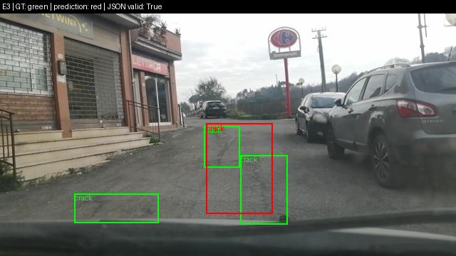

Họ tên: **Bùi Việt Anh**
`dataset_version`: `d10-21e4070301`

## Bảng tổng hợp

Số liệu từ [report/evidence](report/evidence), đối chiếu [notebook đã chạy](lab-day10-results.ipynb). F1 dùng thang 0–1; VRAM tính theo GiB (`bytes / 2³⁰`).

| Mã | Setup | Tham số huấn luyện | VRAM đỉnh (GiB) | Phút train | F1 | CI95 | FP/ảnh | F1 pothole | F1 crack | F1 manhole |
|---|---|---|---|---|---|---|---|---|---|---|
| E0 | zero-shot | 0 | 3,74 | 0 | 0,080 | 0,056–0,106 | 1,061 | 0,106 | 0,019 | 0,179 |
| E1 | LoRA LLM | 33.030.144 | 6,24 | 48,43 | 0,261 | 0,224–0,300 | 1,273 | 0,164 | 0,192 | 0,522 |
| E2 | + projector | 142.135.296 | 7,84 | 48,96 | 0,326 | 0,286–0,364 | 1,219 | 0,192 | 0,267 | 0,579 |
| E3 | + LoRA ViT | 148.426.752 | 8,02 | 57,76 | 0,430 | 0,390–0,472 | 0,929 | 0,286 | 0,350 | 0,716 |
| E4 | E3, data_size 10% | 148.426.752 | 7,68 | 57,27 | 0,289 | 0,252–0,328 | 1,498 | 0,210 | 0,225 | 0,520 |
| E4 | E3, data_size 100% | 148.426.752 | 8,02 | 57,76 | 0,430 | 0,390–0,472 | 0,929 | 0,286 | 0,350 | 0,716 |

- E0 không train; suy luận mất **17,68 phút**, VRAM là đỉnh lúc suy luận.
- E4 mức 100% dùng lại kết quả E3, không phải lần train độc lập.

## 10 câu hỏi

### Câu 1 — Kiến trúc: ViT, projector và LLM có bao nhiêu tham số, E1/E2/E3 cập nhật khối nào?

```text
Ảnh → ViT (306,24M) → projector (109,11M) → LLM + embedding (4.022,47M) → JSON
```

- Tổng **4.437.815.808** tham số; ViT ở trên không tính projector.
- **E1:** LoRA trên LLM; ViT và projector đóng băng.
- **E2:** như E1, thêm cập nhật toàn bộ projector.
- **E3:** như E2, thêm LoRA trên ViT. LLM và ViT chỉ học adapter, không cập nhật toàn bộ trọng số gốc.

### Câu 2 — E0: parse_valid_rate và hai lỗi chính, kèm output thô?

- `parse_valid_rate` = **84,57%**: 263/311 ảnh hợp lệ, 48 ảnh không qua parser.
- Hai vấn đề chính theo scorer là **bỏ sót** (545 FN/583 box thật) và **dự đoán không khớp nhãn/box** (330 FP); riêng crack có 217 FP, 294 FN. Chưa đủ dữ liệu để tách toàn bộ FP thành sai lớp hay sai vị trí.
- Output thô của `vlcsnap-00202` lặp một box hai lần, khiến ít nhất một dự đoán bị thừa:

```json
[{"label": "manhole", "bbox_2d": [309, 685, 399, 714]}, {"label": "manhole", "bbox_2d": [309, 685, 399, 714]}]
```

### Câu 3 — Chấm sai thang 0–1000/pixel ảnh hưởng F1 thế nào? Đã kiểm chứng ra sao?

- Sai thang làm box lệch vị trí/kích thước, giảm IoU nên F1 thường giảm mạnh, có thể về 0. Ảnh 640×360 cần đổi `x_pixel = x × 640/1000`, `y_pixel = y × 360/1000`.
- Notebook vẽ lại 6 ảnh sau khi đổi YOLO → JSON → pixel, sai số tọa độ **≤ 0,5 pixel**.
- Kiểm tra nhỏ khi viết báo cáo bằng scorer gốc: một box đúng `[400,400,600,600]` trên thang 0–1000 đạt **F1 = 1,0**; coi các số đó là pixel thì **F1 = 0,0**. Đây là ví dụ tự tạo, chưa phải phép chấm sai thang trên toàn bộ test E0–E3.

### Câu 4 — Vì sao chỉ tính loss trên phần trả lời?

- Mục tiêu là học JSON đáp án, nên prompt, token ảnh và padding được gán `labels = -100`.
- Mẫu kiểm tra có **572 token**, gồm **220 token ảnh**; chỉ **250 token đáp án** được tính loss. Giải mã phần này thu được JSON và `<|im_end|>`.
- Nếu tính cả đầu vào, model phải học dự đoán lại prompt và token ảnh, làm phân tán việc học đáp án.

### Câu 5 — Vì sao projector không được nén 4-bit khi train đầy đủ? Vì sao dùng float32?

- Trong cách dùng bitsandbytes này, trọng số 4-bit không được cập nhật trực tiếp như tham số floating-point; chỉ thêm LoRA chưa phải học toàn bộ projector.
- Code loại `model.visual`, `visual`, `lm_head` khỏi lượng tử hóa. Kiểm tra xác nhận chỉ **252 module LLM** ở NF4; vision và projector vẫn là floating-point.
- E2/E3 chuyển **109.105.152** tham số projector sang FP32 để giữ gradient phù hợp với `GradScaler` và giảm rủi ro số học; forward vẫn dùng autocast FP16. Đây là lựa chọn của vòng train hiện tại, không phải mọi cách train đều bắt buộc FP32.

### Câu 6 — Vì sao chia theo phiên quay? Số ảnh và box từng split?

- Frame cùng phiên quay thường gần giống nhau. Chia ngẫu nhiên có thể đưa cảnh gần trùng vào cả train và test, khiến F1 cao nhưng không phản ánh khả năng xử lý cảnh mới.
- Notebook đã kiểm tra không có session chung giữa các split:

| Split | Ảnh | pothole | crack | manhole |
|---|---:|---:|---:|---:|
| Train | 1.422 | 1.074 | 1.750 | 691 |
| Val | 276 | 66 | 470 | 103 |
| Test | 311 | 121 | 299 | 163 |

### Câu 7 — Mở projector và thêm LoRA ViT có đáng không?

- **E2 so với E1:** F1 tăng **0,064**, thêm **1,60 GiB** và **0,53 phút**. Có lợi trong lần chạy này, nhưng CI95 còn chồng lấp nên cần kiểm tra thêm.
- **E3 so với E2:** F1 tăng **0,105**, thêm **0,18 GiB** và **8,80 phút**. CI95 E3 **[0,390; 0,472]** nằm trên E2 **[0,286; 0,364]**, cho bằng chứng cải thiện rõ hơn.
- Chọn **E3** khi ưu tiên chất lượng: F1 cao nhất, FP/ảnh thấp nhất, VRAM khoảng **8,02 GiB**. E1 phù hợp hơn khi cần ít VRAM.

### Câu 8 — CI95 rộng thế nào và giới hạn kết luận ra sao với 311 ảnh test?

- Độ rộng CI95 của E0/E1/E2/E3 khoảng **0,049 / 0,076 / 0,078 / 0,082**; E3 có sai số khoảng ±0,041 quanh F1 đo được.
- CI của E1 và E2 còn chồng lấp; E3 tách khỏi cả hai. Tuy vậy, CI từng setup không thay thế phép kiểm tra trực tiếp chênh lệch F1 trên cùng các ảnh.
- Đây là bootstrap theo ảnh và chỉ một seed train. Frame cùng session còn liên quan nhau, nên cần thêm session và nhiều seed để kết luận về cảnh mới.

### Câu 9 — Lớp nào kém nhất, vì sao? Kèm ảnh minh họa.

- Với **E3**, pothole kém nhất: **F1 = 0,286**, so với crack **0,350**, manhole **0,716**; khớp 32/121 box pothole và bỏ sót 89 box.
- Tính từ nhãn test, diện tích box trung vị của pothole khoảng **0,42% ảnh**, manhole **0,67%**, crack **1,98%**. Box nhỏ dễ hụt ngưỡng IoU khi lệch vài pixel.
- Train có 1.074 box pothole, nhiều hơn manhole (691), nên số mẫu không giải thích hết chênh lệch. Pothole có thể khó phân biệt với mảng vá hoặc bóng tối; đây là giả thuyết cần xem thêm ảnh lỗi.
- Ảnh dưới minh họa lỗi định vị crack: box đỏ gộp vùng lớn trong khi nhãn xanh chia nhỏ, đồng thời bỏ sót vết nứt bên trái. Xanh = ground truth, đỏ = dự đoán.



- [Ảnh manhole định vị gần đúng](report/evidence/figures/prediction_1.png) minh họa kết quả tốt hơn ở lớp này. Đủ 6 ảnh dự đoán nằm trong [figures](report/evidence/figures).

### Câu 10 — E4 đổi biến nào, kết quả và độ tin cậy?

- Đổi **data_size: 142 ảnh (10%) và 1.422 ảnh (100%)**, dùng E3 được chọn bằng F1 trên 40 ảnh val (**0,365**). Giữ seed 42, rank 16, LR 2e-4, batch 2, tích lũy 4 và 300 bước.
- Dùng 100% đạt **F1 = 0,430**, hơn 10% (**0,289**) khoảng **0,141**; FP/ảnh giảm **1,498 → 0,929**. CI95 **[0,252; 0,328]** và **[0,390; 0,472]** không chồng lấp.
- Mức 10% có loss cuối **0,013**, thấp hơn 100% (**0,494**) nhưng test kém hơn: dấu hiệu học quá sát tập train nhỏ. Thời gian gần bằng nhau (**57,27 / 57,76 phút**) vì đều chạy 300 bước.
- Kết quả ủng hộ dùng nhiều dữ liệu hơn trong thử nghiệm này; cần nhiều lần lấy mẫu 10%, nhiều seed và test lớn hơn để kết luận rộng hơn.

## Nhìn lại

- JSON hợp lệ chưa có nghĩa là phát hiện đúng: E3 đạt **100% parse hợp lệ** nhưng F1 chỉ **0,430**, vẫn có 289 FP và 344 FN.
- Scorer đếm box không khớp nhưng không tự chỉ ra nguyên nhân do bóng tối, nhãn chưa rõ hay model định vị sai. Cần xem ảnh và output thô để phân biệt.
- Chưa chấm lại toàn bộ dự đoán với sai thang tọa độ và chưa chạy nhiều seed; đây là hai phần cần kiểm chứng thêm. E5 không thực hiện.
